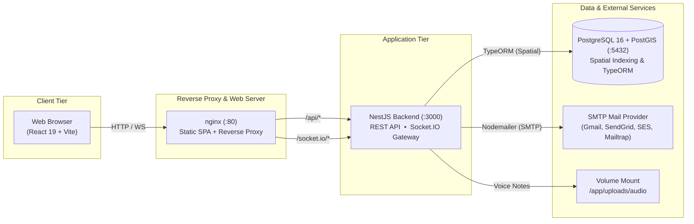

# NearbyChat — Location-Aware Real-Time Chat Platform

A production-ready, full-stack real-time chat application featuring geospatial proximity discovery, bidirectional WebSocket communication, voice notes, transactional email verification, and an administrative control panel.

Built with **NestJS 12**, **PostgreSQL + PostGIS**, **Socket.IO**, and a modern **React 19** frontend styled to match the [Figma Workspace & Chat Area specification](https://www.figma.com/design/uRJShG9KfRw3qylrGqbb5Z/Team-Chat---Workspace-Dashboard-UI--Community-?node-id=2-798).

---

## Architecture Overview



### Monorepo Structure

| Directory | Responsibilities | Key Technologies |
|---|---|---|
| [`chat-app/`](file:///mnt/hdd/nest/project/chat-app) | Backend REST API, WebSocket gateway, auth guards, geospatial queries | NestJS 12, TypeORM, PostgreSQL 16, PostGIS, Socket.IO, Nodemailer |
| [`chat-app-web/`](file:///mnt/hdd/nest/project/chat-app-web) | Figma-inspired SPA, real-time chats, voice recorder, admin panels | React 19, TypeScript, Vite, Tailwind CSS, TanStack Query, Zustand |
| [`docker-compose.yml`](file:///mnt/hdd/nest/project/docker-compose.yml) | Orchestrates database, backend container, and frontend nginx proxy | Docker, Alpine Linux, Multi-stage builds |

---

## Core Capabilities

- **Geospatial Discovery (PostGIS)**: Find active users within a configurable kilometer radius using indexed spatial distance queries (`ST_DWithin` / `ST_Distance`).
- **Real-Time Messaging**: Low-latency direct messaging powered by Socket.IO with optimistic UI updates and REST fallback.
- **Voice Messages**: Record audio directly in-browser (`MediaRecorder`), upload compressed audio blobs, and stream with interactive audio waveforms and seek controls.
- **Figma Design System**: Pixel-aligned UI inspired by the Figma reference design (`#131313`, `#FFEAEA`, `#F8F8F8`, `#E3E3E3`), featuring:
  - Persistent 256px desktop sidebar navigation and responsive mobile bottom nav.
  - Chat window with date dividers, status indicators, and floating input composer.
  - Light and Dark theme toggles.
- **Security & Email Verification**: Argon2/bcrypt password hashing, JWT authentication, protected routes, and transactional email verification with Mailtrap.
- **Administration & Moderation**:
  - User Directory: Search, inspect verification status, filter active/blocked users.
  - Moderation: Suspend/unblock accounts with optional audit log reason.
  - Dynamic Settings: Reconfigure global discovery radius (0.1–500 km) on the fly without restarts.

---

## Quick Start with Docker Compose

Running the entire stack requires only Docker and Docker Compose.

### 1. Configure Environment Variables

Copy the provided `.env.example` to `.env` in the repository root:

```bash
cp .env.example .env
```

Edit `.env` and fill in your secrets:

```dotenv
# Database (PostGIS)
DB_USER=postgres
DB_PASSWORD=your_secure_db_password
DB_NAME=nestjs-chat-app-db

# JWT Secret (Generate: openssl rand -base64 48)
JWT_SECRET=your_long_random_jwt_secret_key

# Public Host URL
DOMAIN=http://localhost/

# Mailtrap Credentials (for email verification)
SMTP_HOST=sandbox.smtp.mailtrap.io
SMTP_PORT=587
SMTP_USER_NAME=your_mailtrap_username
SMTP_PASSWORD=your_mailtrap_password
```

> [!IMPORTANT]
> `docker-compose.yml` strictly enforces mandatory environment variables (`DB_USER`, `DB_PASSWORD`, `JWT_SECRET`, `SMTP_USER_NAME`, `SMTP_PASSWORD`) and will refuse to start if any secret is omitted.

### 2. Build & Launch

```bash
docker compose up --build -d
```

### 3. Access Services

| Service | Address | Description |
|---|---|---|
| **Web Application** | `http://localhost/` | React frontend served via nginx |
| **REST API** | `http://localhost/api` | NestJS backend endpoints |
| **WebSocket** | `ws://localhost/socket.io/` | Real-time chat socket |
| **PostGIS Database** | `localhost:5432` | Exposed PostgreSQL instance |

### 4. Stopping Containers

```bash
docker compose down        # Stop containers while preserving database volume
docker compose down -v     # Stop containers and purge database data
```

---

## Local Development (Without Docker)

### Prerequisites

- **Node.js**: v20 or v22
- **PostgreSQL**: 15+ with **PostGIS** extension enabled (`CREATE EXTENSION IF NOT EXISTS postgis;`)
- **Mailtrap**: Free account for SMTP inbox testing

### 1. Setup Backend (`chat-app`)

```bash
cd chat-app
cp .env.example .env
# Edit .env with your local PostgreSQL and Mailtrap credentials

npm install
npm run start:dev
```

The API will run on `http://localhost:3000/api` with Socket.IO on `http://localhost:3000`.

### 2. Setup Frontend (`chat-app-web`)

```bash
cd ../chat-app-web
cp .env.example .env
# Default points to http://localhost:3000/api and http://localhost:3000

npm install
npm run dev
```

The frontend dev server will launch at `http://localhost:5173`.

---

## Testing Real-Time Chats (Two-User Simulation)

To test location discovery and real-time messaging on a single machine:

1. **User A**: Open `http://localhost/` in a standard browser window and register an account (`user_a`).
2. **User B**: Open `http://localhost/` in an **incognito / private window** and register an account (`user_b`).
3. **Verify Accounts**: Open your Mailtrap inbox, find the verification emails, and click the activation links.
4. **Login & Grant Geolocation**: Log in to both browser windows and allow browser location access when prompted.
5. **Discover & Chat**:
   - Go to the **Nearby** tab on User A: User B will appear with their calculated proximity distance.
   - Click **Message** on User B's card to open the chat window.
   - Send text or recorded voice notes: messages will arrive instantaneously in User B's browser with real-time read receipts.

---

## Environment Variables Reference

| Variable | Target Service | Default | Description |
|---|---|---|---|
| `DB_USER` | `db`, `backend` | *Required* | PostgreSQL database username |
| `DB_PASSWORD` | `db`, `backend` | *Required* | PostgreSQL database password |
| `DB_NAME` | `db`, `backend` | `nestjs-chat-app-db` | Database schema name |
| `DB_HOST` | `backend` | `db` (or `localhost`) | Hostname of the PostGIS database |
| `DB_PORT` | `backend` | `5432` | Port of the PostGIS database |
| `JWT_SECRET` | `backend` | *Required* | Secret key for signing JSON Web Tokens |
| `JWT_EXPIRES_IN` | `backend` | `1d` | Token expiration lifespan |
| `DOMAIN` | `backend` | `http://localhost/` | App base URL used in email activation links |
| `SMTP_HOST` | `backend` | `sandbox.smtp.mailtrap.io` | SMTP host for outgoing transactional emails |
| `SMTP_PORT` | `backend` | `587` | SMTP port |
| `SMTP_USER_NAME` | `backend` | *Required* | SMTP authentication username |
| `SMTP_PASSWORD` | `backend` | *Required* | SMTP authentication password |
| `VITE_API_URL` | `frontend` | `/api` | Base path for backend HTTP endpoints |
| `VITE_SOCKET_URL` | `frontend` | `/` | Base URL for Socket.IO connection |

---

## License

This project is licensed under the MIT License.
