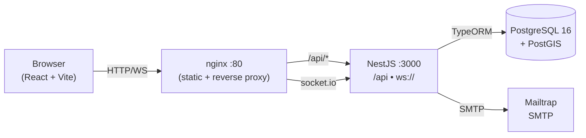

# Chat App — Backend API

A real-time, location-aware chat API built with **NestJS 12**, **PostgreSQL + PostGIS**, and **Socket.IO**.  
Users can register, verify their email, discover nearby people, and exchange text or voice messages — all from a React frontend served behind nginx.

---

## Features

| Area | Details |
|---|---|
| **Auth** | Register · Email verification · JWT login · Role-based guards |
| **Messaging** | Text & audio messages · Socket.IO real-time delivery · Read receipts |
| **Nearby** | PostGIS geography queries — find users within a configurable radius |
| **Admin** | Block/unblock users · Adjust search radius via app settings |
| **Mail** | Transactional email via Mailtrap SMTP (EJS templates) |

---

## Architecture



**Three Docker services, one `docker compose up`:**

| Service | Image / Build | Exposes |
|---|---|---|
| `db` | `postgis/postgis:16-3.5-alpine` | 5432 (internal) |
| `backend` | `./chat-app/Dockerfile` | 3000 (internal) |
| `frontend` | `./chat-app-web/Dockerfile` | **80 (public)** |

---

## Quick Start

### 1 — Clone & configure

```bash
git clone <repo-url>
cd project
cp chat-app/.env.example chat-app/.env
```

Fill in `chat-app/.env`:

```dotenv
DB_USER=postgres
DB_PASSWORD=<strong-password>
DB_NAME=nestjs-chat-app-db

JWT_SECRET=<run: openssl rand -base64 48>
JWT_EXPIRES_IN=1d

DOMAIN=http://localhost/

SMTP_HOST=sandbox.smtp.mailtrap.io
SMTP_PORT=587
SMTP_USER_NAME=<mailtrap-inbox-user>
SMTP_PASSWORD=<mailtrap-inbox-password>
```

> [!IMPORTANT]
> `docker compose` will refuse to start if any required variable is missing — no silent insecure defaults.

### 2 — Start everything

```bash
docker compose up --build
```

| URL | What |
|---|---|
| `http://localhost/` | React frontend |
| `http://localhost/api/` | REST API |
| `ws://localhost/` | Socket.IO |

### 3 — Stop & clean up

```bash
docker compose down          # stop containers, keep volumes
docker compose down -v       # stop + delete DB data
```

---

## Development (without Docker)

```bash
# 1. Start only the database
docker compose up db -d

# 2. Install dependencies
cd chat-app && npm install

# 3. Copy and fill the env file
cp .env.example .env

# 4. Run in watch mode
npm run start:dev
```

---

## Environment Variables

| Variable | Required | Default | Description |
|---|---|---|---|
| `DB_USER` | ✅ | — | Postgres username |
| `DB_PASSWORD` | ✅ | — | Postgres password |
| `DB_NAME` | | `nestjs-chat-app-db` | Database name |
| `DB_HOST` | | `db` (Docker) / `localhost` | DB hostname |
| `DB_PORT` | | `5432` | DB port |
| `JWT_SECRET` | ✅ | — | ≥ 32 random bytes (`openssl rand -base64 48`) |
| `JWT_EXPIRES_IN` | | `1d` | Token lifetime |
| `DOMAIN` | | `http://localhost/` | Used in email links |
| `SMTP_HOST` | ✅ | — | SMTP server |
| `SMTP_PORT` | | `587` | SMTP port |
| `SMTP_USER_NAME` | ✅ | — | SMTP username |
| `SMTP_PASSWORD` | ✅ | — | SMTP password |

---

```bash
npm test               # unit tests (vitest)
npm run test:cov       # with coverage
npm run test:e2e       # end-to-end
```

---

## Tech Stack

- **Runtime** — Node.js, NestJS 12, TypeScript 6
- **Database** — PostgreSQL 16 + PostGIS 3.5 (spatial queries via TypeORM)
- **Real-time** — Socket.IO 4 (`@nestjs/websockets`)
- **Auth** — JWT (`@nestjs/jwt`), bcrypt
- **Mail** — `@nestjs-modules/mailer` + EJS templates
- **File uploads** — Multer (audio messages stored in Docker volume)
- **Testing** — Vitest, Supertest
- **Linting** — OxLint, Prettier
